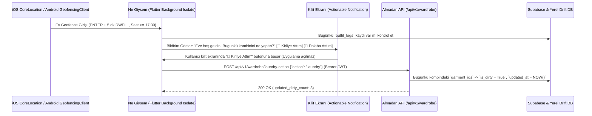

# Konum Tabanlı Otonom Kirli Sepeti ve Etkileşimli Bildirim Stratejisi (Aşama 1.11)

Bu doküman, fiziksel NFC etiketi zorunluluğunu ortadan kaldırarak **Geofencing (Coğrafi Çit)** ve **Etkileşimli Bildirimler (Actionable Notifications)** aracılığıyla kullanıcının eve dönüşünü algılayıp günlük kombinini tek dokunuşla kirli sepetine veya dolaba yönlendiren uçtan uca mimariyi tanımlar.

---

## 1. Uçtan Uca Mimari Akış



---

## 2. Mobil Konum Algılama (Geofencing & Pil Optimizasyonu)

Sürekli GPS (` Geolocator.getPositionStream`) dinlemek yerine işletim sistemi çekirdeği seviyesindeki **Donanım Destekli Bölge İzleme (Region Monitoring)** kullanılır:

- **iOS (`CLLocationManager` / `CLCircularRegion`)** ve **Android (`GeofencingClient`)**:
  - Hücre kuleleri ve Wi-Fi SSID üçgenlemesini kullandığı için pil tüketimi **<%1 / gün** seviyesindedir.
- **Tetikleme Koşulları (False-Positive Koruması)**:
  1. **Yarıçap (Radius)**: Kullanıcının ev koordinatı merkezli `150 metre` yarıçap.
  2. **Bekleme Süresi (`loiteringDelay` / `DWELL`)**: Kullanıcının evin önünden arabayla transit geçmesi durumunda bildirim atılmaması için bölgede en az **5 dakika (`300.000 ms`)** kalması beklenir.
  3. **Zaman Penceresi ve Günlük Tekillik**: Yalnızca `17:30 - 02:00` saatleri arasında, o gün içinde bir `outfit_logs` kaydı mevcutsa ve o gün henüz bu bildirim gösterilmediyse tetiklenir.

---

## 3. Kilit Ekranı Etkileşimli Bildirim Yapısı (`flutter_local_notifications`)

Kullanıcı uygulamayı açmadan doğrudan kilit ekranı (Lock Screen) veya bildirim merkezi üzerinden karar verebilmelidir.

### Kategori ve Buton Tanımları

| Aksiyon ID | Buton Başlığı | Arka Plan Davranışı (`showsUserInterface`) | Gönderilen API Payload |
| :--- | :--- | :--- | :--- |
| `ACTION_LAUNDRY` | `🧺 Kirliye Attım` | `false` (Uygulamayı ön plana getirmez) | `{"action": "laundry"}` |
| `ACTION_CLOSET` | `🧥 Dolaba Astım` | `false` (Uygulamayı ön plana getirmez) | `{"action": "closet"}` |

### Örnek Flutter Bildirim ve Arka Plan İşleyicisi (Background Isolate)

```dart
import 'dart:convert';
import 'package:flutter_local_notifications/flutter_local_notifications.dart';
import 'package:http/http.dart' as http;

const String kLaundryCategoryId = 'HOME_ARRIVAL_LAUNDRY_CATEGORY';
const String kActionLaundry = 'ACTION_LAUNDRY';
const String kActionCloset = 'ACTION_CLOSET';

@pragma('vm:entry-point')
Future<void> onBackgroundNotificationResponse(NotificationResponse response) async {
  final String? actionId = response.actionId;
  if (actionId != kActionLaundry && actionId != kActionCloset) return;

  final String apiAction = (actionId == kActionLaundry) ? 'laundry' : 'closet';
  final String? jwtToken = await SecureTokenStorage.readAccessToken();

  if (jwtToken != null) {
    await http.post(
      Uri.parse('https://almadan.app/api/v1/wardrobe/laundry-action'),
      headers: {
        'Authorization': 'Bearer $jwtToken',
        'Content-Type': 'application/json',
      },
      body: jsonEncode({'action': apiAction}),
    );
  }
}
```

---

## 4. Arka Uç API Sözleşmesi (`app/api/v1/endpoints/wardrobe.py`)

### A) `POST /api/v1/wardrobe/laundry-action`
- **Kimlik Doğrulama**: `Authorization: Bearer <Supabase_JWT>`
- **İstek Gövdesi**:
```json
{
  "action": "laundry"
}
```
- **Sunucu Davranışı**:
  - Kullanıcının bugünkü `outfit_logs` kaydındaki `garment_ids` listesini bulur.
  - `action == "laundry"` ise ilgili tüm kıyafetlerin `garments` tablosundaki `is_dirty` alanını `true` yapar ve LWW senkronizasyonu için `updated_at` zaman damgasını günceller.
  - `action == "closet"` ise kıyafetlerin temiz (`is_dirty = false`) durumunu korur.

### B) `GET /api/v1/wardrobe/laundry-basket`
- **Kimlik Doğrulama**: `Authorization: Bearer <Supabase_JWT>`
- **Sunucu Davranışı**:
  - `is_dirty = true` olan tüm aktif kıyafetleri çeker.
  - Kumaş, tür ve renk özelliklerine göre **Beyazlar**, **Renkliler** ve **Hassaslar** olmak üzere 3 yıkama grubuna ayırır ve her grup için önerilen yıkama sıcaklığı/devir talimatını döner.
